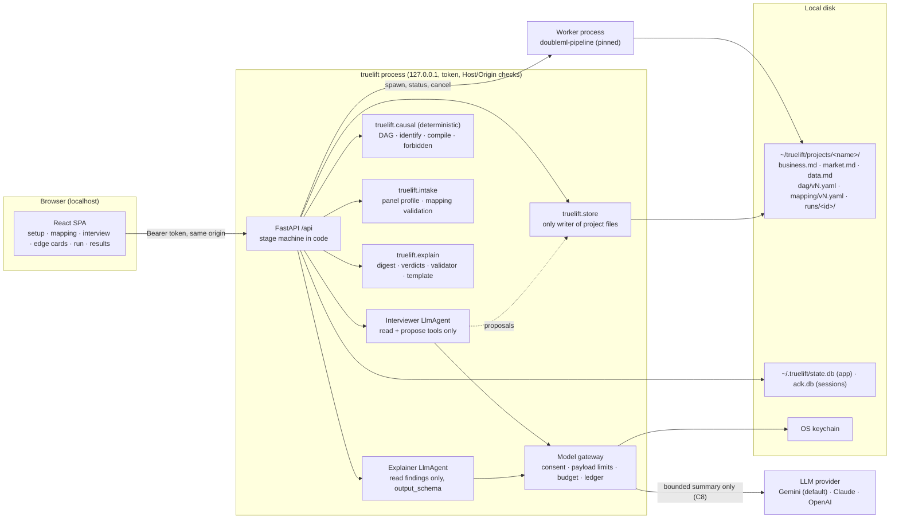

# System design: truelift

Status: **draft**. The decisions marked *user-accepted* were settled in the design conversation on 2026-11-05. The others are recommendations. The open decisions at the end are still unsettled.

Plan, capacity, finish range and cut line: [docs/plans/truelift.md](../plans/truelift.md). They are not restated here.

> **Confidentiality note for this document.** It is public, and it passes the guard it specifies (D13): the hackathon truth-column prefix is never spelled out here. It does not quote or copy the hackathon dataset, the example notebook or the deck, beyond the two numbers the brief allows: true ROI ≈ 2.50 and the expert linear estimate of 1.64 [95% CI −1.64, 4.92]. Contract C13 governs this.

## 1. Summary

truelift is an open-source app that runs on the user's own machine (`localhost`). It acts as the econometrician a marketing leader does not have. It interviews a CMO in plain business language and keeps what it learns in Markdown files the user can read. From the answers it builds a causal DAG, which the user confirms edge by edge. Deterministic code checks that the discount effect is identifiable and compiles the DAG into a [doubleml-pipeline](https://github.com/google/doubleml-pipeline) configuration. The pipeline runs in a local worker process. Finally the app explains the result: incremental revenue, ROI against the user's break-even point, and where and when discounts pay. Every statement in that explanation is labelled fact, inference or hypothesis and cites a pipeline output.

The core principle is that **the model talks and code decides**. The LLM phrases questions, extracts structured answers, proposes changes and writes the narrative. Deterministic code, which Thao can verify, does everything that must be right:

- identification;
- config compilation;
- verdicts;
- number checking;
- every write to the user's files.

## 2. Purpose and constraints

**User and journey.** A CMO at a mid-size skincare brand in India runs weekly discounts across six regions. They suspect that some discounts lose money, but nobody on staff can do causal inference. The journey goes like this:

1. With help from an LLM assistant, they install truelift and run `truelift`. The browser opens on `localhost`.
2. They paste a Gemini key. They read the screen that lists exactly what will leave the machine, and they consent.
3. They upload `sales_panel.csv`. truelift detects a weekly × region panel and proposes roles: outcome, discount rate, discount spend and the others. The user confirms the roles.
4. The interview runs for about 20–30 minutes. Typical questions: "What makes you decide to run a discount in a given week or region?" and "What else changes when you discount: store traffic, search, shelf space?" Each answer becomes a fact in `business.md` or `market.md`, after the user accepts it.
5. The user reviews the DAG as edge cards, for example: *"Festival weeks make you discount more **and** lift sales on their own."* Each card offers Agree, Disagree or Not sure. The identification check passes or says exactly what is missing.
6. They choose **Run**. A Standard run takes minutes; the duration is measured in plan goal G03. The tab can be closed and reopened.
7. Results appear. The page leads with a headline tile, for example "₹2.1 back per ₹1 of discount, 95% range ₹−0.4 to ₹4.6; break-even at your 40% margin is ₹2.5: **undetermined**". It then breaks the result down by region and season and ends with labelled statements, such as *"Hypothesis: January discounts pull sales forward; test by pausing them in two regions."*

**Current friction.** Building a defensible DAG takes a person who knows the business and an econometrician. Most companies have only the first. Running the pipeline by hand also means filling `x_cols`, CATE covariates and normalisation in Python.

**Useful result.** A CMO with no econometrics gets a correct, honestly uncertain answer about discount ROI from their own panel, without anyone else's help.

**What the model contributes.** Plain-language interviewing that adapts to the market, extraction of structured answers, proposals for column mapping and DAG edits, and the narrative explanation.

**What code controls.** It controls DAG construction from confirmed facts, identification, config compilation, run gating, verdicts, number grounding, file writes, consent and spend stops.

**Non-goals for v1:**
- media channels as treatments;
- Meridian prior export;
- anonymisation;
- telemetry or paid support;
- non-panel data;
- multi-user use or hosting;
- self-hosted models.

Section 11 lists the seams that keep these open.

**Observed facts behind this design.** All were read on 2026-11-05.
- doubleml-pipeline 0.2.3 (PyPI, released 2026-10-28) requires Python ≥ 3.10 and is Apache-2.0. It declares no `google-adk` dependency, and its source has **no `agent` module or `Chat` class**. The only agent asset in the repository is the Markdown skill `skills/causal-insights`.
- `CausalWorkflowOrchestrator` has **no seed parameter**. FLAML hyperparameter search is bounded by `time_budget` in seconds, so results depend on CPU speed.
- A `percentage` treatment forces `simple_optimization=True`.
- The pipeline warns when a cluster key has fewer than 30 clusters. It also warns when there are fewer than 1,000 rows and CATE covariates are set.
- The pipeline has **no `margin` parameter**. The ROI threshold is `opt_threshold_roi`, default 1.0.
- The hackathon panel has 804 rows: 6 geos × 134 weeks.
- In the private reference run, the expert linear configuration estimated ROI 1.64 [−1.64, 4.92] against a true 2.50. Saturation fell back to linear, and the run warned about the 6 geo clusters.

## 3. Delivery constraints, depth and deferred controls

| Scope-gate answer | Value |
| --- | --- |
| First useful version due, and what happens after it | No deadline. The project continues as open source. Milestone 1 (M1) is a convincing end-to-end demo that passes the ground-truth benchmark on the public synthetic data and, locally, on the private hackathon CSV. |
| People and hours | Ruslan (lead, agent and backend, knows ADK), Chloe (React), Thao (econometrics). Each has about 2–3 h/week, so 6–9 h/week in total. Estimates use ×1.5 only for Chloe's and Thao's goals that touch the agent. |
| Money | Each end user brings their own LLM key and pays for their own usage. The team's development LLM budget is about **$20/month**. CI uses recorded model replies, and live evaluation runs on demand with a call cap. No cloud spend. |
| Users or judge, and what they read | End users are CMOs and marketing leaders. **The M1 judges are the Google AU Meridian + DML hackathon organisers**, who see a demo plus business and technical presentations. Their feedback gates phase 2. |
| Data touched and effects allowed | The user's aggregated sales panel, which normally holds no personal data. A bounded summary of it goes to the user's chosen LLM provider with their consent (C8). All writes are local, to the user's own project folder. There are no external effects. |
| Portability or lock-in concern | No cloud is involved. Model portability is already a requirement (R6). No portability goal. |
| Delivery profile | **MVP or pilot, self-hosted open source.** Real outside users will run it on real data. Phase 1 is built to demo depth for the organisers. Phase 2 graduates it for the first outside CMOs. |

Depth per concern:

| Concern | Depth now (phase 1) | Trigger that raises it |
| --- | --- | --- |
| Core judgment end to end, measured | Build: the two-tier benchmark (C14) | — |
| Identity | Minimal: a token per launch on a server bound to loopback (D12). There are no user accounts. | Any remote or multi-user mode |
| Secrets | Build: OS keychain, redaction, secret scan (C7, C13) | — |
| External writes and effects | None. Local writes only, gated by proposals the user accepts (C11). | Any integration that writes to an outside system |
| Sensitive data | Minimal: bounded payload, consent, egress ledger (C8). No anonymisation. | Paid support, or a user with personal data in the panel |
| Prompt injection and agency | Minimal: agents hold no write or egress tools (Security posture section) | Any URL fetch, file read outside the project, or write tool |
| Budgets and loop limits | Build: `max_llm_calls` plus a per-project token cap the user can see (C15) | — |
| Memory | Build: project Markdown files as the authority (D1, D4). ADK sessions in SQLite. | Cross-project reusable market packs (Later) |
| Frontend | Build: the SPA journey (D6) | — |
| API contract and typed client | Build: OpenAPI plus a generated client and a drift check | — |
| Web security baseline | The localhost equivalents of tiers 1–3 (section 6) | Remote access, or a release to CMOs (G29 in phase 2) |
| Hosting | Local only. `uv run truelift` from source in phase 1, then `uv tool install` in phase 2 (D11). | — |
| Observability | Minimal: structured local logs without content, plus the egress ledger | Paid support |
| Release engineering | Minimal: exact pins, a release unit (C9), the CI benchmark smoke | Public 1.0 |

**Floor kept at this profile:**
- No secrets in code, prompts, logs or project files (C7, C13).
- A spend stop (C15).
- No external effect, and every file change approved by the user (C11).
- Real data only by the user's own choice and only what consent covers (C8).
- Pinned model IDs (D7).

**Accepted risk.** Data goes to the LLM without anonymisation (decision 8 of the brief). Owner: Ruslan. It ends when the anonymisation add-on ships.

**Who may use it, and graduation.** Phase 1 is for the team and the organisers, on synthetic data and the private CSV. Before outside CMOs use it, it must have:
- an installer for non-technical users (G23);
- interview quality evaluation (G26);
- a privacy and data-flow note (G28);
- a localhost security review (G29);
- recovery of runs after a restart (G25).

| Deferred control | Why it waits | What would bring it forward |
| --- | --- | --- |
| Packaged installer for Mac and Windows (D11) | M1 is demoed by the team from source | First outside CMO (phase 2) |
| Re-adopting a running worker after a backend restart | A re-run takes minutes, and C10 already forbids silent partial results | Run time measured above 20 min, or user complaints |
| DAG and run comparison view | Versions are persisted in phase 1, so only the view waits | First user who re-runs with new data |
| Evaluation of interview leading and contradictions | Needs the question bank and real transcripts first | Before the first outside CMO (G26) |
| OpenAI provider | Gemini and Claude prove the LiteLLM path | Phase 2, or the first user request |
| Saturation runs | `percentage` treatments force the simple optimizer, and the reference run fell back to linear | Spend-type treatment in scope (G27) |

## 4. Requirements and contracts

| ID | Requirement | Need it serves | Status |
| --- | --- | --- | --- |
| R1 | Full loop: interview → DAG → identification → config → local run → explanation. Treatment is discount or promo only. | Core value | confirmed |
| R2 | A non-technical CMO uses it entirely in business language after install | Adoption | confirmed |
| R3 | Weekly date × geo (× category) CSV panels. The agent proposes column roles and the user confirms them. | v1 data shape | confirmed |
| R4 | Wrap doubleml-pipeline; never reimplement DML | Focus | confirmed |
| R5 | The agent proposes the DAG and the user confirms it. The agent blocks the run when identification fails and says what is missing. | Defensible results | confirmed |
| R6 | Model-agnostic with the user's own key: Gemini by default, Claude and OpenAI supported. What leaves the machine is disclosed. | Trust, cost | confirmed |
| R7 | React, FastAPI and ADK. Local, single user. | Team skills | confirmed |
| R8 | Projects with saved interviews, versioned DAGs, mapping, config and run history. Business knowledge kept in reusable Markdown files that update as the work proceeds. | Re-runs, comparison | confirmed (Markdown is the authority: user-accepted) |
| R9 | Proof of correctness: a two-tier ground-truth benchmark plus a comparison with the answer key | Credibility | confirmed (two-tier rule: user-accepted) |
| R10 | Hackathon materials never leave the private folder. Secrets are scanned. | Confidentiality | confirmed |
| R11 | The interview captures local market, seasons, channels and how discount decisions are made | Correct DAG per market | confirmed |
| R12 | Seams for anonymisation, paid support, telemetry, media treatments, Meridian export and non-panel data | Future add-ons | confirmed |
| R13 | Fits 6–9 h/week across three people | Feasibility | confirmed |

Evidence starts as `planned: <check>, <tier>`. Goal IDs refer to the plan.

| ID | From | Invariant | Scope | Authority | Enforcement (and recheck at the effect) | Failure outcome | Evidence |
| --- | --- | --- | --- | --- | --- | --- | --- |
| C1 | R5 | A pipeline run starts only for a DAG version that (a) the user confirmed, (b) passed identification, and (c) uses a confirmed mapping on the same data fingerprint. Each is checked by content hash. | Project, DAG version, data file | Project folder: `dag/vN.yaml`, `mapping/vN.yaml`, confirmation records | The run-gate function in the API's start-run route, and again in the worker before it fits anything | Run refused with the plain reason ("Your DAG changed after you confirmed it: review 2 edges") | planned: G09/A2, G13/A5, local |
| C2 | R4, R5 | The pipeline config is a pure function of (DAG version, mapping, data fingerprint, run profile, compiler version), emitted as canonical JSON. The LLM never writes config fields. | Every run | `truelift.causal.compile` | The compiler is the only constructor of `PipelineConfig`. Agents have no config tool. | Compile error shown; no run | planned: G06/A3, G06/A6, G18/A3, offline |
| C3 | R5, R1 | Identification blocks the run when (a) a descendant of the treatment, such as a mediator, is in the controls; (b) a confounder on an open backdoor path has no column, no approved proxy and no explicit risk acceptance; (c) treatment variation or panel size is below the thresholds in `rules/identification.yaml`; or (d) the panel shape is invalid. Every block names what is missing in business words. | DAG version × mapping × data | `rules/` (owned by Thao); networkx d-separation | `truelift.causal.identify`, called by the run gate (C1) | "Blocked: we need weekly competitor-promo data or an accepted proxy" | planned: G05/A4, G06/A2, G07/A6, offline |
| C4 | R9, R10 | Ground-truth columns (the hackathon truth prefix, `truth_*`, and any column flagged in a benchmark's truth sidecar) are never pipeline features or CATE covariates, and never reach an LLM payload | All data | `truelift/causal/forbidden.py` deny-list | The compiler filter, plus the gateway payload builder (C8) | The column is shown as "ground truth: excluded" | planned: G06/A4, G07/A7, G04/A4, offline |
| C5 | R1, R2 | Every statement in an explanation carries one label: fact (input data), inference (DML output) or hypothesis (a mechanism, with a verification step). It cites ≥ 1 finding ID from that run's digest, and every number in it matches a cited finding value after rounding. | Each explanation | `runs/<id>/digest.json` | The validator in `truelift.explain` checks before the UI shows anything: one repair attempt, then a deterministic template | The template narrative, with a note that the AI narrative failed the checks | planned: G14/A2, G14/A3, G10/A1, offline |
| C6 | R1, R2 | A verdict is computed by code: *worth it* if CI low > threshold, *not worth it* if CI high < threshold, otherwise *undetermined*. No recommendation to cut or increase is made for an undetermined segment. Warnings about few clusters, small samples and sensitivity are shown beside the headline number. | Each finding | Digest | `truelift.explain.verdicts`; the results UI renders tiles from the digest, not from LLM text | Undetermined is shown with "what would make this clearer" | planned: G10/A2, G14/A4, G17/A3, offline |
| C7 | R6 | The API key lives only in the OS keychain (or an environment variable the user set). It never appears in logs, SQLite, project files, prompts, error bodies or the browser bundle, and is sent only to the chosen provider's endpoint. | Machine | `keyring` entry | The key is fetched inside the model gateway at call time; a logging redaction filter; a secret-scan test | The key-entry screen with a plain error | planned: G11/A1, G11/A4, G01/A2, offline |
| C8 | R6 | No LLM call happens before the user accepts the current disclosure version for that provider. A payload holds only the disclosed categories: column names and types, per-column summary statistics, ≤ 20 sample rows (forbidden columns removed), the user's answers, and result aggregates. The raw file is never sent. The provider is the only network destination at run time. | Project × provider | Consent record (`state.db`); disclosure text version | `before_model_callback` in the gateway refuses calls with no consent or an oversized or unknown payload. The egress ledger records categories and byte counts, never content. | The agent pauses with "Review what will be shared" | planned: G11/A2, G11/A3, G15/A2, offline |
| C9 | R8, R9 | Each run records its config hash, data fingerprint, exact versions of the pinned packages, seeds, platform, CPU count and `n_jobs`. A re-run on the same machine reproduces the headline ROI within tolerance δ, which G03 measures. Bitwise equality is not promised. | Run | `runs/<id>/env.json`, `uv.lock` | Worker start-up writes `env.json` before fitting | The run is marked "not reproducible: versions differ" when versions changed | planned: G03/A3, G09/A1, local |
| C10 | R8 | A run's results are shown only when its status is `succeeded` and its manifest lists every expected output with a hash. A page refresh reattaches. A backend restart, worker crash or cancel leaves an `interrupted`, `failed` or `cancelled` status, never a partial result. | Run | `state.db` runs table + `runs/<id>/manifest.json` | Worker writes the manifest last, with an atomic rename. The results API requires status and manifest. Reconciliation runs at startup. | "This run was interrupted. Re-run (about N min)." | planned: G09/A3–A9, G10/A3, local |
| C11 | R8 | Every fact in the project's Markdown carries an ID, a source (answer turn, data profile or agent suggestion) and a status (confirmed, assumed, unknown or contradicted). Agents only *propose* diffs; code applies one only after the user accepts it. A proposal that contradicts a confirmed fact is surfaced, never applied silently. Changing a fact that a confirmed DAG depends on marks that DAG stale. | Project | Project folder files | `truelift.store` (the only writer). Agents hold no file-write tools. | Proposal card stays pending; DAG shown as "needs review" | planned: G08/A2, G08/A4, G08/A6, G13/A3, offline |
| C12 | R3 | A column mapping is confirmed only after deterministic validation of each role: date parses weekly, panel keys unique, rate in [0, 1], spend ≥ 0, outcome numeric, population > 0. A new data fingerprint sends the mapping and DAG back to review. | Project × data version | `mapping/vN.yaml` + validator | `truelift.intake.validate` in the confirm-mapping route | The role cannot be confirmed; the reason is shown per column | planned: G07/A2, G07/A3, G07/A4, offline |
| C13 | R10 | The public repository, its history and the built packages contain no hackathon material, no `private/` file, no hackathon truth-prefix literal outside the two allowlisted files, and no API key pattern. The private benchmark skips itself when its files are absent. | Repo, sdist, wheel | `scripts/guard_public.py` + gitleaks config | Pre-commit hook and a required CI job. Wheel content check at release. | Commit or CI fails, naming the file and pattern | evidenced: local, G01/A1–A6 (A3 CI run owed after push) |
| C14 | R9 | Synthetic tier: over 20 generated datasets, the 95% CI covers the true ROI in ≥ 80% and the median absolute point error is ≤ 20%. Hackathon tier (local only): over 5 pipeline repetitions with the agent-built config, the CI covers 2.50 in 5/5 and the median point estimate is within ±25%. A miss is reported as a finding; the tolerances are not loosened silently. | Release | `truth.yaml`; private truth columns | `truelift bench` scorer. The CI smoke runs one synthetic dataset per PR; the full tiers run at milestones. | M1 is not declared until a tier passes or a recorded decision accepts the shortfall | planned: G10/A5, G18/A2, G19/A1, local |
| C15 | R6 | Each agent invocation is capped by `max_llm_calls`, and each project by a token budget the user can see and change. When the budget runs out, LLM features pause; the deterministic flows (mapping review, DAG cards, runs, digest tiles) stay available. | Invocation, project | `state.db` usage counters from `usage_metadata` | Gateway `before_model_callback` (admission) plus ADK `RunConfig` | "AI paused: budget reached. Raise it or continue without AI." | planned: G11/A5, offline |
| C16 | R7 | The server listens on 127.0.0.1 only. Every `/api` route requires the per-launch token. Requests whose `Host` is not localhost or 127.0.0.1 are rejected, which blocks DNS rebinding. State-changing requests require a same-origin `Origin`. | Machine | Launch token in process memory | FastAPI middleware plus a dependency, failing closed | 401 or 403 with a generic body | planned: G02/A1–A3, offline |

## 5. Architecture and decisions

### Components



Trust boundaries:
- The browser talks to the API only on loopback, with the token (C16).
- The only data that leaves the machine is the gateway's payload (C8).
- The worker is a child process that reads a compiled config and writes only to its own run folder.

### Run sequence (start → results)

```mermaid
sequenceDiagram
  actor U as CMO
  participant UI
  participant API
  participant Gate as run gate (C1)
  participant W as worker
  participant X as explain
  U->>UI: Run (Standard)
  UI->>API: POST /api/projects/{p}/runs {dag: v4}
  API->>Gate: confirmed? identified? mapping fingerprint? hashes unchanged?
  Gate-->>API: ok, compiled config (C2)
  API->>API: insert run row queued; one active run per machine (C10)
  API->>W: spawn process group, runs/{id}/config.json
  W->>W: env.json, re-check hashes, fit; status.json heartbeats + phase markers
  UI->>API: GET /api/runs/{id} every 2 s (survives refresh)
  W->>W: write outputs, then manifest.json via atomic rename; exit 0
  API->>X: build digest + verdicts (C5, C6)
  X-->>API: digest.json; status succeeded
  UI->>API: GET results, then tiles from digest
  API->>X: Explainer narrative, validated (C5) or template fallback
```

### Decisions

| ID | Enforces | Design choice | Reason | Tradeoff / alternative | Verification and expected result |
| --- | --- | --- | --- | --- | --- |
| D1 | C10, C11 | **Two stores.** The project folder is the authority for knowledge, DAGs, mappings, configs and run outputs. SQLite holds operational state: the runs table, project index, consent records, usage counters and ADK sessions (a separate `adk.db`). *User-accepted.* | Markdown and YAML are readable, diffable, portable and easy to hand to support later. Jobs need transactional state. | Two places to keep consistent (D21); no SQL queries over facts. The alternative, SQLite as truth with Markdown exported, was rejected as less portable. | G08/A1, G09/A8 |
| D2 | C2, C3, C11 | **The stage machine lives in code; two narrow agents.** The API owns stages (setup → data → mapping → interview → DAG review → identification → run → results). The *Interviewer* `LlmAgent` has read tools and `propose_*` tools. The *Explainer* `LlmAgent` has one read tool and an `output_schema`. No LLM routing and no `doubleml_pipeline.agent.Chat`. | Stages are known in advance, so ordering belongs to code. The two agents differ in context, tools and evaluation. `Chat` is not in the public package and is Gemini-only per its notebook usage. | Two prompts to maintain. The pipeline's `causal-insights` skill (Apache-2.0) is the reference for labels and verdict wording; truelift adapts it with attribution and does not install it. | G13/A1, G14/A1 |
| D3 | C2, C3, C4 | **Deterministic causal core** `truelift.causal`: a DAG model (networkx), backdoor identification via d-separation, a config compiler and a forbidden-column deny-list. Rules, thresholds, proxies and templates are data files in `rules/` and `templates/`, owned by Thao and protected by CODEOWNERS. | LLMs are unreliable at causal judgments. Thao can read and test YAML rules and golden cases without touching the agent. | The rules must be written out explicitly, which is slower than prompting, but they are verifiable. | G05/A4, G06/A2 |
| D4 | C11 | **Knowledge file format.** Markdown with YAML front matter. Each fact is one bullet with an ID, status, source and the DAG elements it supports (example below). Files: `business.md` (business model, channels, how discounts are decided, margin), `market.md` (country and regions, calendar, seasons, competition, macro factors), `data.md` (column meanings and data-profile observations). Agents write `proposals/` entries; `truelift.store` applies them. | Reusable across projects (copy `market.md`), human-editable, and auditable down to the answer turn | The parser must tolerate hand edits. Errors are shown, never swallowed (G08/A3). | G08/A1–A4 |
| D5 | C3, C11 | **Slot-based interview** (detail in "Interview design" below). Each question fills a slot that maps to a DAG role. The LLM phrases the question and extracts a typed `SlotFill` holding a verbatim quote. The DAG builder (code) turns confirmed facts plus the chosen template into a DAG. | Keeps the LLM's task to language work; DAG structure is traceable to facts | Less free-form than an open chat, but the user can still talk freely and slots are filled from any turn | G13/A2, G12/A2 |
| D6 | C1, C11 | **Edge cards plus a read-only graph.** Each edge is a sentence with Agree / Disagree / Not sure, next to an auto-laid-out graph (React Flow with ELK layout). Every edit goes through the same propose → validate → confirm path. *User-accepted.* | CMOs think in statements, not arrows. This costs about half the effort of a canvas editor. | Users cannot draw arbitrary new nodes in v1; they ask the agent, which proposes. | G16/A2, G16/A3 |
| D7 | C7, C8, C15 | **One model gateway.** Gemini goes through ADK's native model with pinned `gemini-3.8-flash` (stable since 2026-09-02, no shutdown date as of 2026-10-08). Claude and OpenAI go through ADK `LiteLlm`, with pinned IDs in `truelift/models.yaml`; Claude defaults to `claude-sonnet-5-5`. One `before_model_callback` enforces consent, payload categories and size, and the budget. The key comes from the keychain per call. | One choke point for disclosure, spend and the future anonymiser | LiteLLM is an extra dependency and a source of version drift. The alternative, direct SDKs per provider, means more code. | G11/A1–A6; G03/A4 confirms per-call key passing |
| D8 | C10, C9 | **Worker process.** `python -m truelift.worker <run_id>` is spawned in its own process group. It writes `status.json` heartbeats with phase markers parsed from the pipeline log, writes outputs to `runs/<id>/work/`, and writes `manifest.json` last. On backend start, rows marked running with a dead process become `interrupted`. In phase 1 the backend kills the worker's process group on exit, so the run is marked `interrupted` and re-run. | The pipeline uses loky multiprocessing and runs for minutes. Isolating it keeps the API responsive and lets a crash fail honestly. | Re-adopting a live worker after a restart waits for phase 2 (G25). One run at a time per machine, because the pipeline uses all cores. | G09/A3–A9 |
| D9 | C9, C14 | **Run profiles.** *Quick* (lgbm only, one fold setting, small `time_budget`, `top_n=1`, `n_reps=3`) for iterating and for CI. *Standard* (lgbm and xgboost × two fold settings, `time_budget` and `n_reps` from G03, `run_sensitivity=True` with scope total + geo) for decisions. No saturation in v1. | Gives users a fast loop and a trustworthy result. Values come from measurement, not guesses. | Standard may take tens of minutes on older laptops. G03 records the duration. | G03/A2, G09/A10 |
| D10 | C5, C6 | **Grounded explanation.** `digest.json` holds findings with IDs, extracted deterministically from `step4_consolidated_results`, `metadata.json` and the sensitivity metrics. The Explainer returns `Narrative{statements:[{label, text, finding_ids, verification?}]}`. The validator checks citations, numbers, labels and verdict wording. One repair attempt, then a template. Results tiles are rendered from the digest, never from LLM text. | Makes the fact / inference / hypothesis contract checkable by code | The narrative is constrained, so it is less fluent. Questions the digest cannot answer get "not in this run". | G14/A2–A4 |
| D11 | R2 | **Packaging.** A wheel on PyPI ships the prebuilt SPA. Users install with `uv tool install truelift`; uv also provisions Python 3.12. `truelift` opens the browser. Users need no Node; only developers do. A dedicated install page is written for users to paste into their LLM assistant. | Smallest install that brings its own Python and needs no admin rights on Mac or Windows | Heavy wheels (lightgbm, xgboost). macOS may need `libomp`; G03 verifies and G23 handles it. Alternatives: Docker (too heavy for CMOs) and a desktop bundle (Later). | G23 (phase 2) |
| D12 | C16 | **Localhost security.** Bind to 127.0.0.1 on a free port. The CLI opens `http://127.0.0.1:<port>/#token=<random>`; the SPA moves the token to `sessionStorage` and sends it as `Authorization: Bearer`. Host allowlist, Origin check, no CORS, ADK's own server never started. | Stops other local processes and malicious web pages (CSRF, DNS rebinding) from driving the agent or reading data | Opening a new browser needs the launch URL again; the CLI prints it. | G02/A1–A3 |
| D13 | C13 | **Confidentiality guard.** `scripts/guard_public.py` runs from pre-commit and as a required CI job. It denies any path under `private/`; any `*.ipynb` or `*.pdf`; any `*.csv` outside `data/sample/`; the hackathon truth-column prefix (named in the brief) outside `src/truelift/causal/forbidden.py` and the guard itself; and the key patterns `AIza…`, `AQ.…`, `sk-ant-…` and `sk-…`, also enforced by gitleaks custom rules. The private benchmark reads `private/benchmark.yaml`, which lists local paths, and skips when it is absent. Public code never names hackathon files. | The brief's guard list, minus one conflict: the code must name the prefix in order to deny it, so one file is allowlisted | Allowlisting one file is a small hole; CODEOWNERS on that file covers it. | G01/A2–A6 |
| D14 | C14, C4 | **Our own synthetic market** (`truelift.sample`, owned by Thao): a fictional consumer brand in a market other than India, 8 regions × 156 weeks, weekly discount rate plus discount spend. It has confounders (a retail festival that drives both discounting and sales, distribution, media flighting correlated with promos), an optional unobserved confounder switch, a **mediator trap** (store traffic or branded search caused by the discount), heterogeneity (ROI higher in festival weeks, negative in the low season), and `truth_*` columns with `truth.yaml`. Deterministic by seed; 20 seeds for coverage. | Public, so it can power the quickstart and CI. Multiple seeds measure real CI coverage, which one dataset cannot. | The generator must be built and validated (Thao's hours). The panel differs from the hackathon on purpose: same format, different market. | G04/A1–A6 |
| D15 | C14, C2 | **Benchmark harness** `truelift bench`. A scripted persona (YAML answers per slot) drives the *real* Interviewer, with recorded replies in CI and live on demand under a call cap. It produces the DAG, identification and compiled config, runs the pipeline, builds the digest and scores against the truth. CI runs one dataset in Quick mode on every PR; the full tiers run at milestones on a developer machine. | Tests the whole agent-built path, not only the deterministic half | Recorded replies can go stale when prompts change. Live re-recording is part of any prompt change (D16). | G18/A1–A4 |
| D16 | C14 | **Model-agnostic evaluation within $20/month.** Replay fixtures per provider. One live Gemini persona run and one live Claude persona run per prompt change, under a call cap. | Proves the LiteLLM path without a standing spend | Drift between releases is caught only at prompt changes and milestones. | G18/A4 |
| D17 | C8 | **Disclosure screen and egress ledger.** Before the first call, a versioned disclosure lists the provider, the categories (C8) and an example payload built from the user's own file. The ledger page shows every call: time, provider, model, categories, bytes and tokens. | Users see exactly what leaves the machine before it does | One more screen in setup | G15/A2, G11/A3 |
| D18 | C3 | **Thao's role.** Thao owns `rules/` (identification thresholds, proxy rules, the normalisation table), `templates/` (business-type DAGs, written in our own words), the slot catalogue's DAG semantics, the synthetic generator, the golden cases and the benchmark tiers. Thao is a required reviewer for `src/truelift/causal/**` (CODEOWNERS). Thao does not own prompts, but writes what each slot must establish. | Econometric knowledge lives where an econometrician can verify it | Rule changes wait for Thao's review. | G05/A5 |
| D19 | C11 | **Market knowledge.** Once the user states a country and regions, the agent may *suggest* calendar events and seasons from its own knowledge. Each suggestion is a proposal with source `agent suggestion` until the user confirms it. Confirmed events map to holiday columns; if there is no column, the event becomes an unobserved node (C3). | Uses what the LLM knows about markets without treating it as truth | The LLM may miss local events; asking the user for examples covers that. | G13/A9 |
| D20 | C3, C12 | **Deterministic data profiling on upload.** Panel keys, frequency, gaps, missing values, treatment variation by region and season. The results become `data.md` proposals and feed the interview ("Discounts were zero in 17% of weeks, mostly in Jan–Feb: is that a policy?"). | Questions grounded in the data surface the assignment mechanism (confounders) | — | G07/A5, G07/A6 |
| D21 | C10, C11 | **SQLite via SQLAlchemy in WAL mode.** `state.db` for the app; ADK `DatabaseSessionService` on `adk.db`. Postgres was rejected because this is a single-user local install. | No server to install, and a restart keeps state | No concurrent writers across machines, which v1 does not need | G09/A8 |
| D22 | R12 | **Seams, not features.** The gateway payload builder is the single place an anonymiser plugs in. A project export bundle (Markdown, YAML and digest, without raw data) serves paid support. The DAG model allows several treatment nodes, but the compiler accepts one in v1. The digest keeps the ROI distribution for a later Meridian prior export. Intake validators are pluggable for non-panel shapes. | Keeps v1 small without closing doors | — | Review at G21 |

**Versions (working assumptions, confirmed in G01 and G03).** Python 3.12, `google-adk` 2.12.x resolved exactly in `uv.lock` (the specialist guidance was checked against 2.8.0, and 2.12.0 needs Python ≥ 3.11), `doubleml-pipeline==0.2.3` exactly, FastAPI ≥ 0.138, LiteLLM pinned exactly, networkx ≥ 3.3. doubleml-pipeline released three versions in eight days in October 2026. Each upgrade is a release-unit change that re-runs the benchmark (C9, C14).

### Interview design (D5)

The interview runs as **modules**. Each module owns slots, and each slot has a DAG meaning that Thao defines in `templates/slots.yaml`.

| Module | Example opening question (open, not leading) | Slot → DAG meaning |
| --- | --- | --- |
| 1. Business and channel | "Walk me through how a customer ends up buying your product." | Business type → template choice; sales channel; units (regions, categories) |
| 2. Market and calendar | "Which times of year are busiest or quietest for you, and why?" | Seasons, festivals and holidays, weather, macro shocks → common causes of discounting and sales |
| 3. How discounts are decided | "Think of the last few discounts you ran. What made you decide on those weeks, and on how deep?" | **Treatment-assignment drivers → confounders** (the most important module) |
| 4. Other sales drivers | "Apart from discounts, what moves your weekly sales?" | Predictors of the outcome |
| 5. What a discount changes | "When a discount runs, what else changes on the way to the sale: footfall, search, shelf space?" | **Mediators**, excluded from the controls (C3a) |
| 6. Where and when it differs | "Do you think discounts work better in some regions, seasons or situations?" | Effect modifiers → CATE covariates |
| 7. Economics | "Roughly what share of each sale is gross margin?" and "How is discount cost recorded?" | `opt_threshold_roi = 1 / margin`; meaning of the spend column |
| 8. Data check-back | "Your file has a column called `market_sales`. Is that the whole market's sales, or just yours?" | Node → column mapping; proxies; unobserved nodes |

Rules the Interviewer follows (owned by `adk-agent-instructions`, measured in G26):

- One question per turn. Open question first. If options are given, they are balanced and include "not sure" and "something else". The agent never hints which answer lets the analysis pass.
- It asks for concrete examples ("last Diwali, what did you do?") and reflects the answer back in the user's words before proposing a fact.
- **"I don't know"** records the slot as `unknown`. The agent tries one simpler or data-grounded question. If the slot is still unknown, the template default applies, labelled `assumed`, and shown on the edge card. It blocks only if identification needs it (C3b), and then the block offers proxy, risk acceptance or "add data".
- **Contradictions.** If a new answer conflicts with a confirmed fact, the proposal is marked `contradiction`. The UI shows both answers with their turn references, and the user chooses (C11). The DAG derived from the old fact turns stale (C1).
- Data-grounded probes use only the profile facts from `data.md`, not raw rows.

**DAG construction (code).** Start from the template for the business type. Apply confirmed facts as edge assertions (add, remove, reverse) and node mappings. Any edge without a supporting fact is a template default and is shown as `assumed`. The agent cannot add an edge without a fact proposal.

### DAG and mapping → doubleml-pipeline (compiler, D3)

| Pipeline parameter | Derived from | Rule |
| --- | --- | --- |
| `y_col`, `sales_col` | Mapping: outcome (revenue) | `sales_col` is required for `percentage` treatments |
| `d_cols`, `treatment_types` | Mapping: treatment and its kind | A rate in [0, 1] → `'percentage'`; a money amount → `'spend'`. One treatment in v1. |
| `treatment_spend_cols` | Mapping: treatment spend | Required, so that ROI is money ÷ money |
| `x_cols_list` | The identification adjustment set, plus selected predictors, plus region (and category) dummies | Never descendants of the treatment, never forbidden columns (C3, C4). Predictors are capped and dropped at VIF > 10 (rule file). |
| `covariates_for_cate_list` | Confirmed effect modifiers | Pre-treatment only, at most the count in the rule file; `[[]]` when there are none (ATE only) |
| `cate_structure_list` | Rule file | `auto_additive`. With fewer than 1,000 rows, degree ≤ 2. |
| Scaler column lists | Column semantic type, set at mapping time (money or volume, rate, index, flag) → the normalisation table in `rules/` | Per-capita money and volume → `population_median_normalize_cols`. Rates, GRPs and indices → `median_normalize_cols`. Flags and [0, 1] values → none. No standardise or min-max (they break the sign or extrapolation). |
| `date_col`, `geo_col`, `item_col`, `population_col` | Mapping | With no population column, per-capita rules fall back to `median_normalize_cols` |
| `opt_threshold_roi`, `optimize` | The margin fact | `1 / margin`. Defaults to 1.0, labelled assumed. Optimisation is on; a `percentage` treatment forces the simple optimizer (explained to the user). |
| `run_sensitivity`, `sensitivity_scope` | Run profile; risk acceptance (C3b) | Always on in Standard. When a risk was accepted, the robustness value leads the report. |
| Learners, folds, `time_budget`, `top_n`, `n_reps` | Run profile (D9) | Measured in G03 |
| `saturation_config` | — | Not used in v1 (G27) |
| `ground_truth_*` | — | Never set by the product. The benchmark scorer reads the truth separately (C4). |

The few-cluster warning appears whenever the panel has fewer than 30 regions. The explanation says so in plain words: "With 6 regions, the uncertainty range itself is uncertain."

### Knowledge file example (D4)

```markdown
---
project: skincare-in
schema: truelift.knowledge/1
---
# How discounts are decided
- [F012] We discount mostly in festival weeks (Diwali, Holi) and when stock is ageing.
  status: confirmed · source: interview t14 "mostly around Diwali and when stock gets old" · 2026-11-05
  supports: edge(festival_weeks -> discount), edge(inventory_age -> discount)
- [F013] Competitor promotions do not influence our discount calendar.
  status: assumed · source: template default · supports: no-edge(competitor_promo -> discount)
```

### Model-facing interfaces

| Surface | Interface | Implementing skill and verification |
| --- | --- | --- |
| Instructions | Interviewer: module goals, non-leading rules, slot catalogue reference, proposal discipline. Explainer: labels, citation rule, verdict wording comes from code, "not in this run". Both versioned as code in `truelift/prompts/`. Identification, verdicts and numbers stay in code. | `adk-agent-instructions`; a rendered-request snapshot test |
| Tools and budgets | Interviewer (≤ 8 tools): `get_stage_state`, `get_data_profile`, `get_knowledge`, `propose_fact`, `propose_mapping`, `propose_dag_edit`, `check_identification` (read-only result), `ask_user_choice`. Explainer (1 tool): `get_findings(ids?)`. Results are bounded (≤ 4 KB) and carry a status and actionable errors. There are no write, file, shell or URL tools. | `adk-tool-interface-design`; a declaration dump with sizes |
| Output schema and model | `SlotFill`, `Proposal` and `Narrative`, each with a refusal or `cannot_answer` shape. Pinned per provider (D7). Bounded repair: 1 attempt, then a template or a pause. | `adk-model-and-output-contracts`; a scripted test of invalid output (prose, fenced JSON, valid-but-wrong) |

## 6. Data and authority

| Data / operation | Owner and authorized scope | Writers / readers | Source and freshness | Lifetime / erasure |
| --- | --- | --- | --- | --- |
| Uploaded CSV (`projects/<p>/data/vN.csv`) | The user | Intake and worker read it; nothing writes after upload | The user's file, with its fingerprint | Until the user deletes the project or the data version |
| Knowledge Markdown | The user | `truelift.store` (after acceptance) and the user by hand; agents read through tools | Each fact's source and date | Project lifetime. Copyable to other projects. |
| Proposals | The user | Agents create (through code); `store` applies or rejects | Agent turn ID | Kept as an audit trail |
| DAG and mapping versions | The user | `store` (immutable once written) | Fact IDs and fingerprint | Project lifetime |
| Run folder | The user | Worker (`work/`, `manifest`), `explain` (`digest`, `narrative`) | Run ID, config hash | Until deleted. About 10–100 MB per run, to be measured in G03. |
| `state.db` (runs, consent, usage, index) | Local app | API | Live | Machine lifetime |
| `adk.db` (sessions, events) | Local app | ADK Runner | Live | Project lifetime. Deleted with the project. |
| API key | The user | Setup writes it; the gateway reads it | Keychain | Until the user removes it. "Forget key" deletes it. |
| LLM payloads | Leave the machine to the provider under consent | Gateway | Per call; the ledger keeps metadata only | Provider retention, explained on the disclosure screen |

### Security posture

| Agent | Private data | Untrusted content | Write or egress | Resolution |
| --- | --- | --- | --- | --- |
| Interviewer | Data profile, knowledge, answers | Column names and cell values in the user's own CSV (low risk) | Egress only to the LLM provider. No write tools: only proposals, which code applies after a user click. | A leg is removed: no autonomous write, no URL fetch. G13/A6 checks injected text in a column name. |
| Explainer | Digest | Pipeline outputs, generated locally | None | Read-only, schema-bound |

Tool tiers: everything is *read*, except `propose_*`, which creates a pending proposal and changes no authority. There is no irreversible tier and no code executor.

#### Web security baseline

The server is a single-user app bound to loopback, so the identity-provider rules are replaced by the launch token (D12).

| Rule | Component | Depth now | Proved by (G/A), n/a: reason, or deferred: trigger |
| --- | --- | --- | --- |
| SB01 | `/api` routes | Build (launch token) | G02/A1 |
| SB02 | Identity | Minimal (launch token, not an IdP) | G02/A2 |
| SB03 | Agent routes | Build | G13/A7 |
| SB04 | Records | n/a: single local user, no other principals | n/a: single local user |
| SB05 | ADK runtime | Build | G02/A4 |
| SB06 | API configuration | Build (no CORS) | G02/A3 |
| SB07 | API configuration | Minimal (`nosniff`, `frame-ancestors`, CSP; docs served only in dev builds) | G02/A5 |
| SB08 | Browser credentials | Build (bearer in header, never in query; token in the fragment only at launch) | G02/A2 |
| SB09 | API inputs | Build | G02/A6 |
| SB10 | Browser app | Build | G17/A4 |
| SB11 | Uploads | Build | G07/A1 |
| SB12 | Outbound fetch | n/a: no URL fetch anywhere | n/a: no URL fetching |
| SB13 | Errors | Build | G02/A6 |
| SB14 | Logging | Minimal (no content, key redaction) | G11/A1 |
| SB15 | Supply chain | Minimal (lockfiles, audit in `make check`) | G01/A5 |
| SB16 | Secrets | Build | G01/A2 |
| SB17 | Agents with tools | Build | G13/A6 |
| SB18 | External effects | n/a: no external effects; local writes gated by C11 | n/a: no external effects |
| SB19 | Cost and abuse | Build | G11/A5, G09/A6 |
| SB20 | Identity | n/a: no IdP tokens to revoke | n/a: launch token per process |
| SB21 | Deployment | n/a: no deployed staging | n/a: nothing deployed remotely |
| SB22 | Whole application | Defer | deferred: before first outside CMO (G29) |
| SB23 | Whole application | Defer | deferred: paid support or 1.0 |
| SB24 | Whole application | Defer | deferred: any remote or hosted mode |
| SB25 | Public endpoints | n/a: no public endpoint | n/a: loopback only |

## 7. Budgets and capacity

These are working assumptions until G03, G13 and G14 measure them.

- **Interview.** About 20–40 user turns, roughly 2 model calls per turn including tool calls, at about 6–15k input tokens per call once stable-prefix caching and history compaction apply. That is roughly 0.3–1M input tokens and 20–40k output tokens per interview. Measured in G13/A8. Cost is shown to the user as tokens plus an estimate from the provider's current price page, dated, never hard-coded.
- **Explanation.** About 1–3 calls, each with roughly 10–15k input tokens. Follow-up questions run about 5k each.
- **Stops (C15).** `max_llm_calls` = 12 per invocation. The default project budget is 2M tokens, which the user can change. A 429 gets at most 2 retries with backoff, then a pause.
- **Pipeline.** Runs locally on all cores (`n_jobs=-1`), one at a time. The assumption is Quick ≈ 2–6 min and Standard ≈ 10–30 min on an 8-core laptop, replaced by G03 figures. Wall-clock caps are set at 3× the measured median.
- **While waiting.** The user sees a phase progress bar from the pipeline's phase markers, elapsed and expected time, "you can close this tab", and a summary of the assumptions they confirmed, to review in the meantime.
- **Disk.** Run folders are retained, and a "delete run" action is available. Expected size is measured in G03.

## 8. Failure and recovery

Coverage grid. "Write outcome unknown" for the model means there is no side effect.

| Integration | Unavailable or slow | Rejects the request | Write outcome unknown | Partial multi-step change | Credential expired or revoked | Rate limited or out of quota | Duplicate or concurrent request | Untrusted or malformed content |
| --- | --- | --- | --- | --- | --- | --- | --- | --- |
| LLM provider (Gemini, Claude, OpenAI) | G11/A6 | G11/A4 | n/a: model calls change nothing | G13/A5 | G11/A4 | G11/A5 | G02/A7 | G13/A4, G14/A3 |
| Pipeline worker (doubleml-pipeline) | G09/A3, G09/A5 | G09/A4 | G09/A3 | G09/A3 | n/a: local process, no credentials | n/a: local compute has no quota | G09/A6 | G10/A3 |
| OS keychain | G11/A7 | G11/A7 | G11/A7 | n/a: single key item | G11/A4 | n/a: local OS service | n/a: single local user | n/a: stores user-entered key only |
| Project folder files | G08/A5 | G08/A5 | G08/A5 | G08/A6 | n/a: local files, no credentials | n/a: local disk has no quota | G08/A7 | G08/A3 |
| SQLite state (`state.db`, `adk.db`) | G09/A8 | G02/A6 | G09/A8 | G09/A8 | n/a: local file, no credentials | n/a: local file, no quota | G09/A6 | n/a: written by app code only |
| Uploaded CSV | n/a: local upload, no service | G07/A1 | n/a: read only after upload | n/a: read only after upload | n/a: no credential involved | n/a: local file, no quota | G07/A4 | G07/A2, G13/A6 |

Action grid:

| Action | Over-broad or wrong target | Partially applied | Confirmation stale or changed | Outcome unknown | Repeated or concurrent |
| --- | --- | --- | --- | --- | --- |
| Apply knowledge proposal | G08/A4 | G08/A6 | G08/A7 | G08/A5 | G08/A7 |
| Confirm DAG version | n/a: confirms one version hash | G08/A6 | G09/A2 | G08/A5 | G08/A7 |
| Confirm mapping | n/a: confirms one mapping version | G08/A6 | G07/A4 | G08/A5 | G08/A7 |
| Start run | n/a: one run per request | G09/A3 | G09/A2 | G09/A8 | G09/A6 |
| Cancel run | n/a: cancels one run id | G09/A9 | n/a: no confirmation involved | G09/A9 | G09/A9 |

Cross-cutting scenarios:

| Failure window | User-visible outcome | Retained state / possible effects | Safe next action and recovery owner |
| --- | --- | --- | --- |
| Wrong column mapping (e.g. spend mapped as the rate) | The validator blocks the role (C12). If the mapping is plausible but semantically wrong, the interview's data check-back (module 8) and the edge cards surface it. | Mapping version unconfirmed | The user corrects it; the agent re-proposes |
| User contradicts an earlier answer | A contradiction card shows both answers (C11) | Both are kept in the proposal history; the DAG turns stale | The user chooses; the DAG is re-confirmed |
| Pipeline crash mid-run | "Run failed: <plain reason>". No numbers are shown. | Config, log and partial `work/` are kept for debugging; no manifest | Re-run; logs available for a support export |
| LLM outage or invalid key | "AI unavailable" banner; the deterministic flows keep working | Session saved; nothing applied | Retry, or change provider or key |
| Too little data or treatment variation | Identification blocks with the threshold and the actual value (C3c) | Project intact | Add data or regions. The rule's owner is Thao. |
| Wide CI that the CMO might over-read | Verdict "undetermined", warnings beside the number, no cut or raise advice (C6). The Explainer states what would narrow it (more weeks, a holdout test). | — | Hypotheses carry verification steps |
| Backend restart during a run | "Interrupted. Re-run (about N min)." | Row reconciled at startup | One-click re-run (C10) |
| Hand-edited Markdown breaks syntax | Parse error with the file and line (C11) | The file is unchanged by the app | The user fixes it, or "restore last good version" |
| Upgrade of the pipeline version | Old runs are labelled with their versions (C9) | — | Benchmark re-run before release (C14) |

## 9. Verification and implementation handoff

- **Offline (every PR).** Golden identification and compiler cases, the property test that no forbidden or descendant column appears in `x_cols`, the validator's scripted invalid outputs, the confidentiality guard, recorded-reply agent tests and the Quick synthetic smoke.
- **Local integration.** Worker kill, restart and cancel; atomic writes; refresh-reattach in a real browser (Playwright, G20).
- **Live, bounded.** A Gemini and a Claude persona interview per prompt change, under a call cap, from the $20/month budget.
- **Milestone.** The full synthetic tier (20 seeds, Standard) and the private hackathon tier (5 reps) on a core developer's machine, recorded in the plan with versions (C9).
- **Answer-key comparison (R9b).** This is a private, local note in `private/`. It compares the agent's `x_cols`, CATE covariates and normalisation with the expert notebook and explains each difference. The public plan records only the outcome numbers and a summary such as "n differences, all explained".
- **Outcome measure.** Phase 1 measures correctness (C14), not business benefit. Business usefulness is a hypothesis, tested in phase 2 with pilot CMOs: did they complete the journey unaided, and did they understand the verdict?
- **Release unit.** The `truelift` version, `uv.lock` (including doubleml-pipeline, ADK and LiteLLM), prompt versions, model IDs and recorded-reply fixtures move together.

The implementation route per goal is in the plan.

## 10. Not in v1, but not blocked

| Later capability | Seam that keeps it open (D22) |
| --- | --- |
| Media channels as treatments | The DAG model allows several treatment nodes. The compiler's single-treatment assertion is the place to lift. `x_cols_list` is already per treatment. |
| Meridian prior export | `digest.json` keeps the ROI and contribution distributions; an exporter can read them |
| Data anonymisation | The gateway payload builder is the only egress point |
| Paid support and opt-in telemetry | Project export bundle; the egress ledger as the telemetry pattern |
| Non-panel data | Intake validators are a registry keyed by data shape |

## 11. Open decisions

| Question or assumption | Why it changes the design | Owner / evidence needed | What it blocks |
| --- | --- | --- | --- |
| Run-profile values and tolerance δ | Sets user wait time, the CI budget and C9 | Ruslan, G03 measurements | G09 caps, G18 |
| Can FLAML's tuned hyperparameters be frozen for re-runs (better reproducibility)? | Could make C9 near-deterministic | Ruslan, G03 | Nothing (improvement only) |
| Identification thresholds (minimum weeks, regions, treatment variation) | Decide when users are blocked | Thao, G05, sourced | G07/A6 |
| Synthetic market choice and DGP parameters | Public demo story; benchmark difficulty | Thao, G04 | G18 |
| Whether the ±25% hackathon tolerance is achievable with an agent-built config | C14 may need a recorded decision | G19 result, then Ruslan and Thao | M1 declaration |
| macOS `libomp` and Windows behaviour of lightgbm, xgboost and loky | Install path D11 | G03 (Mac), G23 (Windows) | G23 |
| Default Claude and OpenAI model IDs | Cost and quality for non-Gemini users | Ruslan, G11 and G26 | — |
